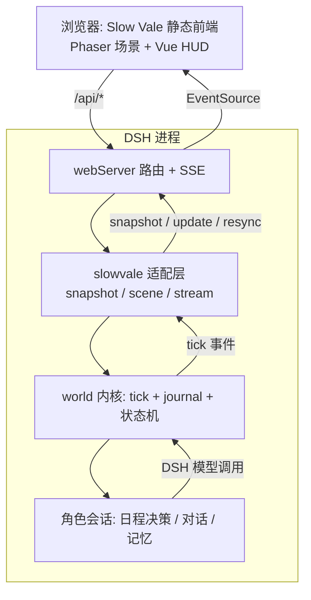

# 用 Slow Vale 取代 agent-world：迁移计划

## 0. 先说三个前提（决定了整个计划长什么样）

1. **两边是同一个渲染器**。agent-world 的 ARCHITECTURE 写的是 Phaser 3.90，Slow Vale 的 GameView 也是 Phaser 3.90.0 —— 引擎层没有迁移成本，要换的只有**内容、交互、以及一根协议**。
2. **服务端就在 DSH 里**。现在的 agent-world 已经是这个形态：cordis 插件 + tick 内核 + journal + webServer/SSE，角色 = 真实 DSH 会话。所以"服务端基于 dsh 搭建"不是新建，而是**扩内核**，不引入 Python/Node 独立后端。
3. **前端是编译产物，改它最贵**。Slow Vale 的 129 个端点是黑盒（只有消费代码可读）。所以策略是：**后端适配前端，不改前端**。已经在本地验证过——满足 10 个端点 + 快照必填字段，画布就能起来。

## 1. 换什么、留什么

| 层 | 现在的 agent-world | 迁移后 | 动作 |
| --- | --- | --- | --- |
| 渲染器 | Phaser 3.90（vendored） | 同版本 | **留** |
| 运行内核 | tick 100ms + journal + 确定性回放 | 同一套 | **留** |
| DSH 桥接 | persona / session / teams / dispatch | 同一套 | **留并扩** |
| 世界模型 | 站点(station) / 工单(task) / 团队 | 地点(place) / 日程 / 角色 / 关系 / 经济 / 工单 | **扩** |
| 场景内容 | 自绘办公室 tilemap（1 个场景） | Slow Vale 32 张城市图 + 室内 | **换** |
| 美术 | 自制/采购像素图 | Slow Vale 全套（含角色合成层 432 张） | **换（注意版权）** |
| HUD/交互 | 看板 / dock / sidebar / 气泡 | Slow Vale 的 Vue HUD（手机、短信、资产、日志） | **换** |
| 线协议 | 自己的 wire（seq + gap 自愈） | Slow Vale 协议（snapshot + SSE，protocol_version 76） | **新增适配层** |

一句话：**保留"世界怎么转"，替换"世界长什么样、玩家怎么碰它"。**

## 2. 目标架构

关键：**适配层是唯一懂 Slow Vale 协议的地方**，内核继续用自己的领域模型与协议。前端再变，只改这一个文件。

## 3. 协议对接：最小必需集

只做下面这些就能进游戏并看见角色（其余按面板渐进补，未实现的返回空结构）：

| 端点 | 作用 | 优先级 |
| --- | --- | --- |
| POST /api/auth/login、/auth/me、/auth/refresh | 本地账号（DSH 会话即身份，可免密） | P0 |
| POST /api/auth/select-role | 进世界前的准入 | P0 |
| GET /api/world/list、/world/{id}/info | 世界卡片 | P0 |
| GET /api/role/list | 角色卡 | P0 |
| GET /api/game/state/world | 世界快照（必填字段见 MOCK-BACKEND.md） | P0 |
| GET /api/game/state/scene | 场景快照（world_id/cursor/tick_marker/scene/actors/place_runtimes…） | P0 |
| POST /api/game/stream-ticket + EventSource /api/game/stream | 实时：connected / update / resync | P0 |
| GET /api/registry/items、/recipes | 物品注册表（可先空） | P0 |
| POST /api/game/player/message | 短信：玩家 → 角色 | P1 |
| GET /api/game/phone/{threads,thread,contacts} | 手机面板 | P1 |
| GET /api/game/logs/{recent,catch-up} | 日志/回顾 | P2 |
| /api/game/market*、/shop/*、/game/finance/* | 经济 | P2 |
| /api/admin/* | 管理台（前端页面已存在） | P3 |

铁律：**snapshot 的 cursor 必须严格接续**（epoch 是字符串、seq 单调），否则前端判定丢包并 resync。我们的 journal 正好提供这个语义。

## 4. 服务端（DSH 侧）怎么搭

### 4.1 角色 = 真实会话，但决策要"事件驱动 + 低频"

- 每个角色绑定一个 DSH 会话（沿用现在的 session-world 绑定）。
- **不是每个 tick 调模型**：tick 只跑确定性模拟（位置、日程、状态衰减）。模型调用只发生在四类事件：日程切换、被玩家发消息、与人相遇聊天的机会、事件冲突。
- 目标预算：每角色每小时 2–6 次调用；24 角色按活跃时段错峰。这是整套系统成本的主要来源，必须在 P1 就设上限（每日 token 预算 + 降级为模板行为）。

### 4.2 时间与确定性

- 世界时钟（day/minute）+ tick 固定步长，写入 journal；所有变更走命令（command），可回放。
- 回放决定前端能否"重连补齐"：给定 epoch/seq，任何时候重放得到同一状态。

### 4.3 记忆

- 每角色一份 profile + 记忆条目（append-only）。检索按"人物/地点/最近"三路召回，塞进决策提示。
- 可复用现有 bridge/persona-prompt 与灵枢记忆，但**先做最简单的文件版**，别一开始接图存储。

### 4.4 内容

- 地图：Slow Vale 的 32 张直接吃；**P1 只启用 6 张**（家、街、便利店、公园、公司、酒吧），其余等场景交互补齐再开。
- interactions → 已有 station/anchor 概念做映射：spawn/transition 直接对应，pose 对应"可停留点"，field_area 对应"工作区"。
- 角色外观：character_generator 432 张分层合成，直接对应现有 avatar 管线。

## 5. 阶段与验收

| 阶段 | 时间 | 交付 | 验收（可测） |
| --- | --- | --- | --- |
| P0 打通 | 3–5 天 | 适配层 + 10 个 P0 端点 + 1 张图 + 3 个角色 | 打开 /world/w1 画布起来；3 个角色沿固定日程在城里走动；刷新后位置连续；断网重连能 resync |
| P1 生活闭环 | 1–2 周 | 6 张图 + 寻路 + 日程 + 短信 + 记忆 | 给角色发短信能收到回复（走真实模型）；角色会自己上班/回家；日志能看到这两件事 |
| P2 经济与工作 | 2–3 周 | 工单↔工作映射、钱包、商店、市场面板 | 派一张工单 → 角色接单 → 走到站点 → 完成 → 钱包变化，全链路 UI 可见 |
| P3 多世界与运营 | 3–4 周 | 多世界隔离、存档迁移、管理台、回放工具 | 两个世界并行互不串味；能从 journal 重放出任意时刻画面 |

每个阶段都要求：**回放一致性测试 + 一条 e2e（浏览器里跑）**。这是这个项目最容易腐化的两处。

## 6. 明确不做（防止摊大饼）

- 不复刻 Slow Vale 的抽卡、月卡、Apple IAP、付费墙（/shop/* 只做钱包与购买道具的本地版）。
- 不追前端协议的全量 129 端点；面板打不开就先空着，别为它加假数据层。
- 不做原生壳（Capacitor）、不做热更新（OTA）——我们不需要。
- 不重写 Phaser 场景基类：已有场景装配够用，只换地图数据与美术。

## 7. 风险与对策

| 风险 | 影响 | 对策 |
| --- | --- | --- |
| 前端协议黑盒 | 某些面板永远打不开 | 最小必需集 + 逐面板补齐；把"哪个面板缺哪个字段"记在 MOCK-BACKEND.md |
| LLM 成本失控 | 账单爆炸 | P1 就设每角色/每日预算，超限降级为模板行为 |
| 确定性被破坏 | 回放/重连错乱 | 所有变更必须经命令 + journal；禁止在渲染层改世界 |
| 素材版权 | 不能对外发布 | 内部原型可用；对外必须替换素材或取得授权（LimeZu 商用授权 + 作者许可） |
| 上游更新 | Slow Vale 协议漂移 | 静态站已固化（2401 文件 + sha256），**不跟随上游**，我们自己演进 |

## 8. 第一步（本周就能做完的三件事）

1. 复制 mock-api.mjs 成 `lib/adapters/slowvale/`，把返回数据源从硬编码换成 world 快照（约 200 行）。
2. 在 webServer 上挂 `/api/game/state/world|scene` + `/api/game/stream`，SSE 从 journal 推 update。
3. 用 downtown_street 一张图跑通：3 个角色 + 固定日程（起床→出门→上班→回家），浏览器验收。

做完这三件，后面就只是"往同一个骨架里填内容"，而不是"再换一次架构"。

## P0 落地状态（本轮已完成）

### 已删除

| 路径 | 是什么 |
| --- | --- |
| src/web/ · lib/web/ | 旧面板前端（Phaser 场景 + 看板 + dock + 对话 UI，约 2.3 MB） |
| src/client.js · lib/client.js | 客户端插件入口（conversation.view 注册） |
| src/routes/panel.ts · src/routes/vendor.ts | 静态面板与 vendored 资源路由 |
| lib/vendor/phaser · lib/vendor/pixi | 旧渲染器（Slow Vale 自带 Phaser 3.90） |
| scripts/copy-web.mjs · scripts/build-subagent-view.mjs | 旧前端的构建脚本 |
| test/client-plugin.test.js · test/e2e-web.test.js · test/vendor.test.js | 只测旧前端的用例 |

保留 lib/vendor/easystar（sim/pathfind.ts 在用，和 Slow Vale 是同一个库）。

### 已新增

src/adapters/slowvale/ —— 唯一懂 Slow Vale 协议的地方：

| 文件 | 职责 |
| --- | --- |
| project.ts | 内核世界 → 快照/场景/世界卡/角色卡（纯函数，无 IO） |
| routes.ts | P0 的 10 个端点 + 未实现端点的显式 501 清单 |
| static.ts | 静态站服务（SPA fallback；/assets/ 缺文件严格 404） |
| server.ts | 独立端口 + SSE（connected 带全量快照，之后按周期 resync） |

配套：scripts/slowvale-dev.mjs（不启宿主就能看效果）、test/slowvale-adapter.test.js（6 个用例）、
配置项 slowvale.*（默认关闭，在 cordis.patch.yml 打开）。

### 验证

node --test test/ → 794 通过 / 0 失败；tsc --noEmit 干净。

浏览器实测（scripts/slowvale-dev.mjs + 本地静态站）：

- 登录 → 数据授权 → 新手引导 → 世界大厅 → 角色页 → 进入游戏：全链路通过；
- Phaser 画布起来（1025×804），124 个地图资源按 place_id 加载；
- SSE 每秒推送，cursor.seq 连续增长，前端不报协议错；
- 面板缺失时给的是"P0 未实现：/game/recap"这种能照做的提示，而不是空白或假数据。

### 还差什么（下一步，属于 P1）

角色还没出现在画面里（chars=0：前端拉 character_generator 的那一步没被触发）。
不是外观缺字段，而是给精灵上帧的那条链路要的是视觉时间线：

1. visual_timeline 现在是空数组——前端靠它把"谁在哪一帧"播出来；
2. actor 已经引入了，但 place_runtimes 为空，场景层没有可挂载的运行时；
3. 真正的逐帧更新走 SSE 的 update 信封（kind/route/cursor/prev/tick_marker），
   P0 为了不写错协议用了 resync 全量推——世界会变，但不会播帧。

所以 P1 第一件事不是加内容，是把视觉时间线接上：把内核的移动/动作翻译成 visual_timeline 的
lane packet，或改成发 update 信封。这件事做完，角色才会真的走起来。

## 免登录直达 + 办公室场景（本轮）

### 已做

1. **自动进入**（`slowvale.autoEnter`，默认开）：适配层在返回 index.html 时**运行时注入**一段脚本，
   沿真实流程点一遍（登录 → AI 数据授权 → 新手引导 → 世界 → 角色 → 世界）。
   磁盘上的静态产物一个字节没改，sha256 仍对得上（注入只在响应里做）。
   实测：打开 `/` 直接落到 `/world/w1`，canvas 847×804 就位，无需任何点击。
2. **场景改成办公室**：`slowvale.place = place:office.tech_company_1`。
   这个 id 不是猜的——Slow Vale 的场景注册表里 `place:office.tech_company_*` 按规则映射到
   `assets/maps/company`（也就是办公室那张图）。现在 company 的四件套（objects/collisions/layers/interactions）已在预取。

### 还差一步（像素没出来）

canvas 有了，但 `background.png` 没被请求——**场景挂载**这一步还是缺。

本轮试过三种推送方式，结论如下（都留着记录，省下一次重试）：

| 方式 | 结果 | 结论 |
| --- | --- | --- |
| 每秒 resync 全量快照 | canvas 稳定在，地图元数据在取，背景不加载 | 保底方案，**能进游戏但不播帧** |
| `update` 信封 + `payload_gz: null`（kind=scene_state） | canvas 时有时无 | 前端不会为空 payload 去拉 /game/state/scene，反而抖 |
| `update` 信封 + gzip 场景载荷 | canvas 直接崩掉 | 载荷形状没对上 applySceneState，别在半懂的情况下发 |

所以下一步不是继续猜信封，而是**先把 applySceneState 的入参对齐**：
它要的字段（scene / role_presences / actors / place_runtimes）我们都有，差的是"触发它的那一次调用"。
定位方法：在 GameView 里搜 `scene_state` 的消费分支，看它解出 payload 后调的是哪个函数，
再用 /game/state/scene 的返回体做对照（两者应当同构）。

这件事和"角色走路"是同一个根：**视觉管道**。做完它，办公室场景和角色会一起出现。

## 城市里有一个人在走（/show）

### 做了什么

在 HUD 的场景挂载还没通的情况下，用**同一套资产**做了个最小渲染器，先把"有人在这个城市里走"立住。

| 文件 | 职责 |
| --- | --- |
| src/adapters/slowvale/stage.ts | 状态机：每张图取交互点（spawn/target/pose）当路点，直线走过去；走满 3 个点换下一张图 |
| src/adapters/slowvale/viewer.ts | /show 页面：Canvas2D，底图 + 物件按 y+delta 排序 + 人物分层合成，相机跟随 |
| scripts/slowvale-dev.mjs | 每 100ms 推一次 stage，世界快照里的位置也取自它（两个页面看到同一个人） |

路线（6 个主要场景循环）：company（办公室）→ commercial_street → convenience_store → park → restaurant → home_public → 回到办公室。

### 关键数据（不是猜的）

角色帧来自 PersonalityPicker.js 的动画表：walk 在第 2 行，方向块起点 right 0 / up 6 / left 12 / down 18，
各 6 帧，帧 32×32；idle 在第 1 行。角色由 4 层合成（Body / Eyes / Outfit / Hair），
路径 /assets/character_generator/bundles/base/<Part>/<file>。

### 实测

- /api/show/state 连续采样：company → commercial_street → park → restaurant → home_public → company（循环成立）
- /show 页面：canvas 1222×804，非背景像素采样 9.8 万，background.png 已加载，4 张角色层已加载
- 500ms 内 drawImage 调用 93 次（约 15 帧 × 底图+物件+4 层人物）—— 真的在画，不是静止图
- 截图：artifacts/slowvale-walk.jpg

### 这一层与 HUD 的关系

stage 产出的就是"谁在哪、朝哪、在不在走"，正是 HUD 的 presence 需要的形状。
等 scene_state 管道对齐后，把这个 frame 直接喂给 presence 即可，**不用再写一遍**。
所以这不是绕路，是把渲染管道从最难的一端（前端协议）换到最确定的一端（自己的画布）先跑通。

## 用后端驱动 HUD（本轮）

### 收获：place id 与 asset 名是两套东西

前端只认 place:office.tech_company_1 这种 id，靠规则表映射到 assets/maps/<asset>。
之前把 asset 名当 place_id 传，得到的是一连串"一切都 200 但场景起不来"：

| 症状 | 真因 |
| --- | --- |
| display-gap place.name 未登记: commercial_street | presence 里塞的是 asset 名，不是 place id |
| Vue 组件异常 reading 'name' | viewer.core 缺 basic_info（HUD 的 role 是它包出来的） |
| Vue 组件异常 reading 'map' | presence 缺 titles 数组（同场景列表直接读它） |
| AssetMissingError portrait_generator | 头像素材不在 app-bundle 里，和服务端要 |

### 现在的进度

后端补齐之后，**HUD 已经能完整渲染**（前端零改动）：

- 自动登录直达 /world/w1；
- HUD 显示「阿吉 · 观察中 · 在场 2 人 · 现场 · 当前场景」，同场景列表正常；
- 头像能画（补下 portrait_generator 280 张：Skins 9 / Eyes 7 / Hairstyles 200 / Accessories 64）；
- 控制台错误 0。

### 还差一处：城市视口

HUD 里的 PhaserCanvas 由 isPhaserSceneActive 控制，而它由**场景运行时提交场景**点亮。
我们给的是 HTTP 快照（推 resync），没有走 scene_state/visual 管道，所以这个开关不亮。

这一处仍是同一个根：视觉管道。补齐它，城市视口就会出现在 HUD 里，而且**位置数据已经就绪**
（stage 产出的 place/x/y/facing 就是 presence 需要的形状）。

### 新增的可诊断性

slowvale.debug 打开时，后端会往 index.html 注入一个采集脚本（不碰产物），
把 console 与未捕获异常收进 window.__svlog。这一轮就是靠它把三个坏字段逐个逼出来的。
