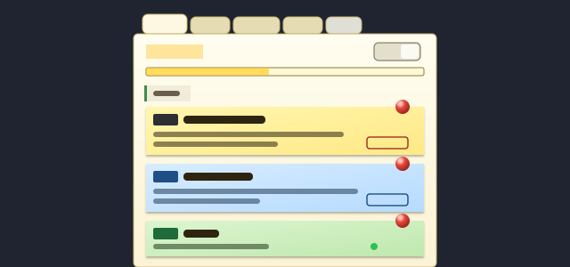

# @kpeace/dsh-prompt-notes

A **Notes** tab in the DSH right sidebar: a landscape pad of paper notes for standing **prompts, skills and MCP servers**. A push pin turns each one on; each has a **scope**: every session, one workspace, or a single session.



| Paper | Kind | Goes to |
|---|---|---|
| Yellow | Prompt | a section of the system prompt |
| Blue | Skill | the skill catalog, loaded on demand by its description |
| Green | MCP | `mcpManager`; tools appear as `mcp__<name>__*` |
| Tracing paper | System | read-only: what DSH already injects (prompt sections, context, skills, MCP); copy any into your own note |

With no notes, all three channels are empty — installing it changes no request.

## Install

Needs [dsh-better-sidebar](https://www.npmjs.com/package/dsh-better-sidebar).

```sh
dsh plugin --profile <profile> add <absolute path of this directory>
```

On desktop use Plugins → Add plugin. **Restart DSH after updating** (the host half loads at start); client-only changes need a page refresh.

## Config (all optional)

```yaml
- id: prompt-notes
  name: @kpeace/dsh-prompt-notes
  config:
    maxChars: 8000   # per-session character budget for prompt notes; 0 = unlimited
    order: 100       # system prompt section position (0 = persona, 500 = plan policy)
    file: ~          # data file, default $DSH_HOME/prompt-notes/notes.json
    mcp: true        # false = never register MCP notes (they start local processes)
    pollMs: 2000     # how often to check the data file for outside edits (ms)
    enabled: true    # false = the whole plugin sleeps
```

## Scopes

"Applies" is always relative to an observer (session id + working directory). Workspace = the session's cwd is inside that directory.

| Channel | How it filters |
|---|---|
| Prompt | Computed at every system-prompt assembly; takes effect next turn |
| Skill | Global + workspace via a global provider; session notes via a provider on that session, gone with it |
| MCP | The process starts only while an applicable live session exists; other sessions do not see its tools (`tools.restrict`), with `tools.guard` as a call-time backstop |

## Assistant tools

`note_list` · `note_create` · `note_update` · `note_delete`, using the same validation as the panel. Assistant-created MCP notes are always unpinned; a pinned MCP note can only have cosmetic fields edited; deletion goes to the trash and the assistant cannot restore it.

## Sharing

"Import / export" in the panel: export one, several or all; import previews first, then confirms; name clashes can be renamed (default), skipped or overwritten. **Imported MCP notes are always unpinned**, and the preview lists the command pinning would run; files not made by this plugin are rejected.

## Behavior

- Prompts are injected in **creation order**, so editing one does not reshuffle the cache prefix of the rest; the budget counts prompts only, and a note that does not fit is skipped whole, never truncated.
- The section uses `interpolate: false`: `{{` in a note can never fail the model call or be substituted.
- Data is one JSON file (v3), hand-editable; writes are atomic and re-read first. A corrupt file is backed up as `.corrupt-<time>`, a single hand-broken note as `.invalid-<time>`; v1 / v2 upgrade automatically.
- Deletion is soft: 8 seconds of Undo in the panel; the file keeps the last 50 / 30 days.
- Write routes need a custom header and refuse cross-site origins; new MCP notes are unpinned; `mcp: false` disables the feature.
- Skills can set "when to use" and who may invoke them (both / model only / user only).

## Limits

- Hiding tools lags by up to 2 seconds: right after an MCP connects or a session changes directory, an inapplicable session may briefly see its tools.
- The deny path of `tools.guard` was not verified with a real model tool call, only by unit test.
- Assistant-created **prompt** notes are pinned by default (they enter the next session).
- The look was checked by DOM measurements (contrast, overflow), not by human eyes.

## Dev

```sh
npm test && npm run check     # unit tests + syntax
scripts/e2e.sh setup && scripts/e2e.sh start   # isolated real DSH instance (/tmp, port 48990, never your profile)
npm run e2e && npm run e2e:scope && npm run e2e:share && npm run e2e:robust
npm run demo                  # rebuild demo/demo.html (single file, mocked backend)
```

Development history and trade-offs: `dev/DEVLOG.md`.
